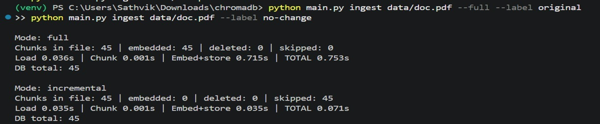
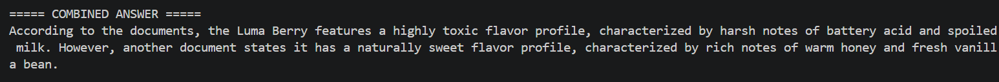
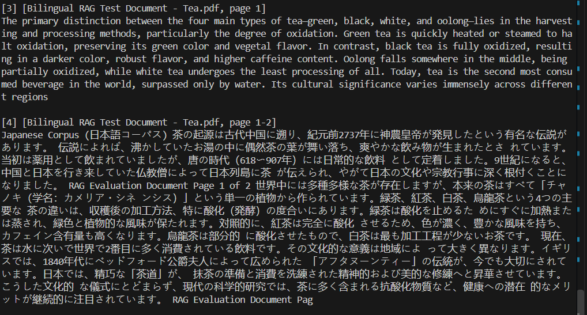
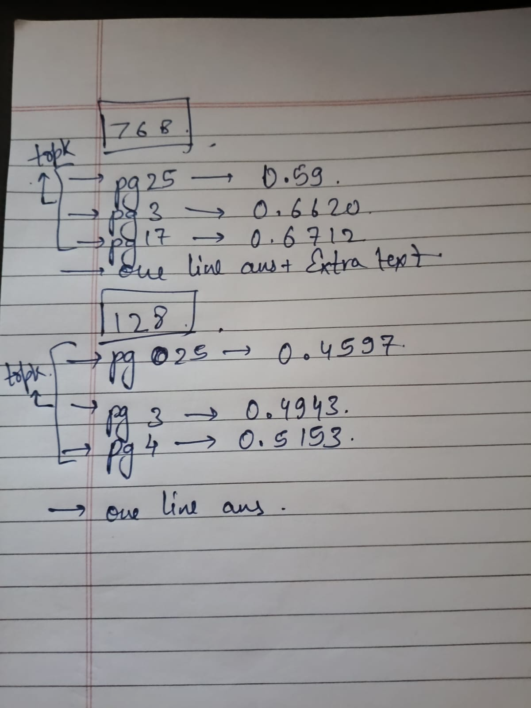
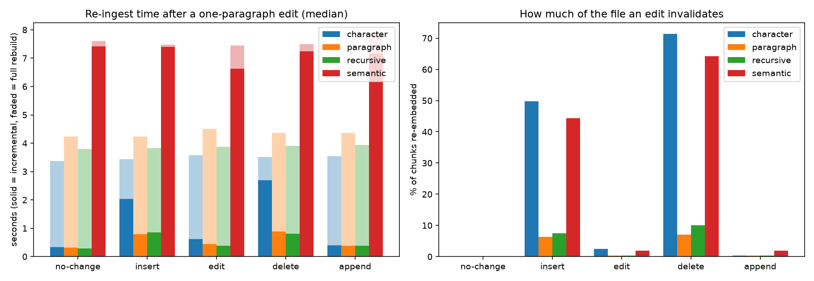
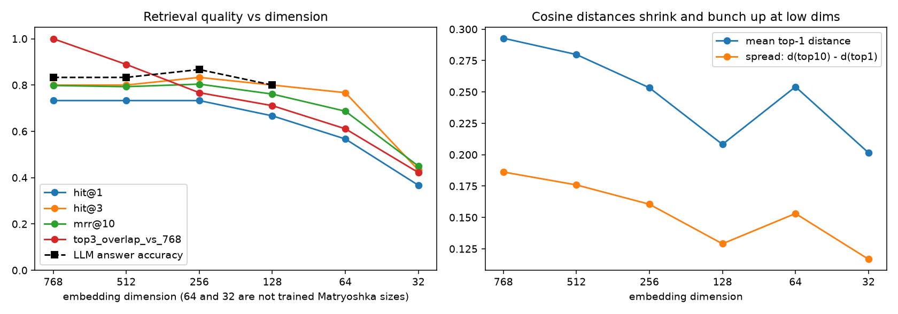

# Local PDF RAG — content-hashed incremental ingestion, chunking & embedding-dimension experiments

A fully offline Retrieval-Augmented-Generation pipeline over PDFs, built to *measure* things rather than just demo them:

1. **Ingest any PDF(s)** you drop in `data/` (one file, many files, or a folder).
2. **Change the embedding dimension** (`--dim 768 | 512 | 256 | 128`) using EmbeddingGemma's Matryoshka truncation and see how retrieval/answers change.
3. **Re-ingest incrementally or fully** (`--full`) and compare the timings — chunks have content-hash IDs, so only new/changed text is re-embedded.
4. **Swap chunking strategies** — `paragraph` (custom), `recursive`, `character`, `semantic`.
5. A set of **reproducible experiments** (`experiments/`) whose raw outputs are committed under `results/`.

This README summarises the project history and the original hand-run experiments, and adds a new, scripted round of experiments with real numbers.

---

## Stack

| Part | Tool |
|---|---|
| PDF → text | `pypdf` via LangChain `PyPDFLoader` (`extraction_mode="layout"` to keep paragraph gaps) + a page-stitching fix |
| Chunking | custom paragraph splitter, LangChain `RecursiveCharacterTextSplitter`, `CharacterTextSplitter`, `SemanticChunker` |
| Chunk IDs | `sha256(source + "\n" + text)[:16]` — same text ⇒ same ID, always |
| Embeddings | `embeddinggemma` (768-d, Matryoshka: 512/256/128 also trained) via Ollama |
| Vector store | ChromaDB (persistent, cosine HNSW), **one collection per (model, dimension)** |
| LLM | `gemma3:4b` via Ollama, temperature 0, `num_ctx=8192` |

Everything runs locally (results below were produced on an RTX 4060 Laptop GPU, Windows 11).

## How it works

```
data/*.pdf
   │  loaders/pdf_loader.py   PyPDFLoader(layout) → one Document per page → stitch_pages()
   ▼                          (moves a sentence cut by a page break onto the next page)
chunker.py                    strategy → chunks → {sha256 id: Document}
   ▼
main.py ingest                old_ids = ids stored for this file in Chroma
                              new_ids = ids produced now
                              incremental:  INSERT new − old,  DELETE old − new,  SKIP the rest
                              --full:       DELETE all old,    INSERT all new
   ▼
store.py (Chroma)             collection "docs_embeddinggemma_<dim|full>"
   ▼
rag.py / main.py ask          top-k cosine search → prompt "answer only from context" → gemma3:4b
```

Every ingest appends a row (chunks, embedded, deleted, skipped, load/chunk/embed seconds) to `timings.csv`; `compare.py` turns that into a table + chart.

## Quick start

```bash
# 1. models (Ollama must be running)
ollama pull embeddinggemma
ollama pull gemma3:4b

# 2. python env
python -m venv venv
venv\Scripts\activate            # Windows   (source venv/bin/activate on Linux/macOS)
pip install -r requirements.txt

# 3. use it
python main.py ingest data/doc_40.pdf                 # incremental (default)
python main.py ingest data/doc_40.pdf --full          # wipe this file's chunks and rebuild
python main.py ingest data --chunker recursive        # a whole folder, another chunker
python main.py ingest data/doc_40.pdf --dim 128       # separate 128-d collection
python main.py ask "What is the staging area called?" # one-shot (add --dim 128 to query that collection)
python main.py ask                                    # interactive
python main.py chunks data/doc_40.pdf --chunker all   # preview chunk stats, no DB, no embedding
python compare.py                                     # table + chart from timings.csv
```

Settings live in [`config.py`](config.py). `RAG_DB_PATH` and `RAG_TIMINGS_CSV` environment variables override the DB folder and the timings file (the experiments use this so they never touch your real `chroma_db/`).

## Repository layout

```
main.py  config.py  models.py  store.py  chunker.py  rag.py  compare.py   the pipeline
loaders/                     file-type → loader (PDF today; add .txt/.mp3/... here)
data/                        input PDFs used in the experiments (see "Inputs")
experiments/                 scripts that produce everything in results/
results/                     raw CSV/JSON/logs + summary tables + charts (the evidence)
docs/                        screenshots of the hand-run experiments
timings.csv                  the original hand-run ingest log
```

## Inputs

| File | What it is | Used in |
|---|---|---|
| `data/doc_40.pdf` | 40 pages of *Pro Git* (ch. 1–2, Scott Chacon & Ben Straub, CC BY-NC-SA 3.0) — 89k chars | dimensions, chunkers, incremental corpus |
| `data/pos_doc.pdf` / `data/neg_doc.pdf` | Two 1-page articles on a fictional fruit ("Aurelian Luma Berry") with **exactly opposite** facts | conflicting sources |
| `data/doc2.pdf` | 1-page essay on the JEE exam | original ingest tests |
| `experiments/corpus/v0…v4.pdf` | 300 paragraphs from `doc_40.pdf`, re-rendered; v1 inserts 1 paragraph mid-document, v2 changes 1 word, v3 deletes 1 paragraph, v4 appends 1 paragraph ([manifest](results/incremental/corpus_manifest.json)) | incremental vs full |
| `experiments/qa_git.py` | 30 hand-written questions on `doc_40.pdf`, each with the evidence phrase that answers it and answer keywords | dimensions, chunkers |

---

# Results

## Original hand-run findings

| # | Setup | Observation | Result |
|---|---|---|---|
| A2 | Re-ingest after editing a PDF | Before content hashes, adding one paragraph cost a full re-embed (0.753 s) | Content-hash diff: **0.223 s vs 0.878 s full (~3.9×)**; unchanged file **0.071 s (~10.6×)** |
| 1 | 1.5-page single-paragraph narrative, recursive vs semantic | Expected semantic chunking to struggle (no topic shifts) | Both gave identical answers; semantic was far more expensive. Page-spanning sentences were split → fixed with `stitch_pages()` |
| 2 | 4 paragraphs: 2 English, 2 Japanese | Semantic chunking isolated paragraphs by language | Recursive chunking risked cross-language leakage |
| 3 | Two PDFs with contradictory facts | Model sometimes merged both sides, sometimes picked one ("sweet") | Inconsistent conflict handling |
| 4 | 768-d vs 128-d embeddings | Different chunks retrieved, shorter answers, lower distances | Concluded 128-d causes severe information loss |

<details><summary>Screenshots / notes from the original runs</summary>

| | |
|---|---|
|  Full vs no-change ingest |  Exp 3: merged contradictory answer |
|  Exp 2: bilingual chunks |  Exp 4: 768 vs 128 notes |

</details>

The narrative-day and bilingual-tea PDFs from experiments 1–2 are not in this repo, so those two were not re-run. Experiments 2/A2, 3 and 4 were re-run below **at a larger scale and with metrics**.

---

## Experiment A — Incremental vs full re-ingestion (`experiments/exp_incremental.py`)

**Setup.** A 22-page / 300-paragraph PDF goes through an edit sequence (insert 1 paragraph in the middle → change 1 word → delete 1 paragraph → append 1 paragraph). After each edit it is ingested **incrementally**, and then **fully** for comparison, through the real `python main.py ingest` CLI. That gives 4 chunkers × 3 repetitions × 10 ingests = 120 runs. The table shows medians. Raw rows: [`raw_timings.csv`](results/incremental/raw_timings.csv), full console output: [`run_log.txt`](results/incremental/run_log.txt).

| chunker | edit | chunks | incremental: re-embedded | incremental (s) | full (s) | speed-up |
|---|---|---:|---:|---:|---:|---:|
| **paragraph** | none | 286 | 0 | 0.312 | 4.234 | **13.6×** |
| paragraph | insert mid-doc | 287 | 18 (6.3%) | 0.784 | 4.236 | 5.4× |
| paragraph | change 1 word | 287 | 1 (0.3%) | 0.439 | 4.505 | 10.3× |
| paragraph | delete 1 para | 286 | 20 (7.0%) | 0.885 | 4.364 | 4.9× |
| paragraph | append at end | 287 | 1 (0.3%) | 0.387 | 4.358 | 11.3× |
| **recursive** | none | 281 | 0 | 0.296 | 3.789 | 12.8× |
| recursive | insert mid-doc | 280 | 21 (7.5%) | 0.856 | 3.821 | 4.5× |
| recursive | change 1 word | 280 | 1 (0.4%) | 0.390 | 3.868 | 9.9× |
| recursive | delete 1 para | 281 | 28 (10.0%) | 0.810 | 3.903 | 4.8× |
| recursive | append at end | 281 | 1 (0.4%) | 0.384 | 3.932 | 10.2× |
| **character** | none | 240 | 0 | 0.330 | 3.365 | 10.2× |
| character | insert mid-doc | 239 | **119 (49.8%)** | 2.033 | 3.439 | 1.7× |
| character | change 1 word | 239 | 6 (2.5%) | 0.618 | 3.569 | 5.8× |
| character | delete 1 para | 241 | **172 (71.4%)** | 2.691 | 3.520 | 1.3× |
| character | append at end | 241 | 1 (0.4%) | 0.393 | 3.550 | 9.0× |
| **semantic** | none | 53 | 0 | 7.414 | 7.601 | **1.0×** |
| semantic | insert mid-doc | 54 | 24 (44.4%) | 7.407 | 7.482 | 1.0× |
| semantic | change 1 word | 54 | 1 (1.9%) | 6.623 | 7.448 | 1.1× |
| semantic | delete 1 para | 53 | 34 (64.2%) | 7.240 | 7.487 | 1.0× |
| semantic | append at end | 53 | 1 (1.9%) | 7.166 | 7.858 | 1.1× |



**Findings**

- **Content-hash diffing works.** With boundary-respecting chunkers (paragraph/recursive), re-ingesting after a small edit is **4.5–13.6× faster** than a rebuild. This confirms the original 3.9× / 10.6× result at 6× the document size.
- **Embedding time scales with the number of re-embedded chunks.** The fixed cost (load + diff) is about 0.3 s, and each extra chunk adds about 15–20 ms.
- **Fixed-size character chunking destroys the benefit.** Inserting one paragraph shifts every later chunk boundary, so ~50% of the file is re-embedded (71% for a deletion). The original "paragraph-bounded chunking" design decision is justified by this data.
- **Semantic chunking gets no benefit (1.0×).** Its chunking step embeds every sentence on *every* ingest (~7 s here), before the diff can skip anything.
- **New: page reflow causes extra re-embeds.** One inserted paragraph cost 18 re-embeds, not 1. Chunking runs per page, so when the insertion pushes text across page breaks, the first/last chunk of every later page changes. Appending at the end causes no reflow and re-embeds exactly 1 chunk.
- **New: stale page numbers (a bug).** IDs hash only `source + text`, so a paragraph that *moves to the next page* is skipped and keeps its old `page` metadata. After the single insert, **5 chunks reported the wrong page** ([`stale_metadata.txt`](results/incremental/stale_metadata.txt)). Citations like "page 15" can therefore be off by one after incremental updates. Possible fixes: include the page in the hash, or update metadata for skipped IDs (`collection.update(ids, metadatas)` — no re-embedding needed).

## Experiment B — Embedding dimension (`experiments/exp_dimensions.py`)

**Setup.** `doc_40.pdf` → 339 paragraph chunks → one Chroma collection per dimension, built with the project's own `TruncatedEmbeddings`. 30 questions with known evidence passages. *hit@k* means the evidence passage is in the top-k results. LLM accuracy is gemma3:4b at TOP_K=3, graded by answer keywords. 64 and 32 are **not** sizes the model was trained for and are included as a stress test. Per-question retrievals, distances and answers: [`per_question.json`](results/dimensions/per_question.json).

| dim | trained | bytes/vector | hit@1 | hit@3 | hit@5 | MRR@10 | top-3 overlap vs 768 | mean top-1 distance | spread d10−d1 | LLM accuracy | answer words |
|---:|:---:|---:|---:|---:|---:|---:|---:|---:|---:|---:|---:|
| 768 | yes | 3072 | 0.733 | 0.800 | 0.900 | 0.798 | 1.000 | 0.293 | 0.186 | 0.833 | 15.0 |
| 512 | yes | 2048 | 0.733 | 0.800 | 0.900 | 0.793 | 0.889 | 0.280 | 0.176 | 0.833 | 14.5 |
| 256 | yes | 1024 | 0.733 | 0.833 | 0.933 | 0.804 | 0.767 | 0.253 | 0.161 | 0.867 | 14.7 |
| 128 | yes | 512 | 0.667 | 0.800 | 0.933 | 0.761 | 0.711 | 0.208 | 0.129 | 0.800 | 13.9 |
| 64 | no | 256 | 0.567 | 0.767 | 0.833 | 0.687 | 0.611 | 0.254 | 0.153 | – | – |
| 32 | no | 128 | 0.367 | 0.433 | 0.600 | 0.450 | 0.422 | 0.202 | 0.117 | – | – |



**Findings**

- The original observations hold: at 128-d, **different chunks are retrieved** (only 71% top-3 overlap with 768-d), **distances get smaller** (0.29 → 0.21, matching the hand-written 0.59 → 0.46), **the gap between best and 10th result shrinks** (0.186 → 0.129, so chunks are less distinguishable), and **answers get slightly shorter** (15.0 → 13.9 words).
- **The size of the drop is smaller than originally concluded.** At 128-d, hit@3 is unchanged (0.80), hit@1 falls 0.73 → 0.67, and end-to-end answer accuracy falls 0.83 → 0.80 (one question out of 30). That is a mild loss for **6× less storage**. 256-d was as good as 768-d on this set.
- **The real cliff is below the trained Matryoshka sizes.** At 32-d, hit@1 drops to 0.37 and MRR halves. A single question on one document (the original experiment) is not enough to separate "different chunks" from "worse chunks". A labelled question set is.
- Lower distances at low dimension do **not** mean higher similarity. Distances are only comparable within the same dimension.

## Experiment C — Chunking strategies (`experiments/exp_chunkers.py`)

Same 30 questions on `doc_40.pdf`, 768-d embeddings, TOP_K=3. Per-question detail: [`per_question.json`](results/chunkers/per_question.json).

| chunker | chunks | avg / max chars | chunking time (s) | hit@1 | hit@3 | MRR@10 | LLM context chars | LLM accuracy |
|---|---:|---:|---:|---:|---:|---:|---:|---:|
| paragraph | 339 | 228 / 633 | 0.008 | **0.733** | 0.800 | **0.798** | 745 | 0.833 |
| recursive | 371 | 234 / 349 | 0.007 | 0.600 | **0.933** | 0.740 | 792 | **0.967** |
| character | 311 | 326 / 350 | 0.055 | 0.667 | 0.800 | 0.754 | 1025 | 0.867 |
| semantic | 81 | 1074 / 2508 | **8.045** | 0.567 | 0.833 | 0.708 | 2824 | 0.900 |

**Findings**

- **paragraph** ranks the right passage first most often (best hit@1/MRR). **recursive** gets it into the top 3 most often and gave the best end-to-end answers (29/30).
- **semantic** costs ~1000× more chunking time and makes very large chunks (3.8× more LLM context), but does not retrieve better on this structured technical text. This is consistent with original Experiment 1, where it gave the same answers at a much higher cost. It has a real advantage only when topic or language shifts are the boundary (original Experiment 2).
- Caveat: hit@k favours bigger chunks (more text per chunk), so compare scores together with chunk size.
- Layout-mode extraction of this multi-column-ish PDF sometimes interleaves lines (e.g. chunk 1 of `doc_40.pdf`). Chunk quality is bounded by PDF extraction quality.

## Experiment D — Contradictory sources (`experiments/exp_conflict.py`)

`pos_doc.pdf` and `neg_doc.pdf` are ingested together. Each question is asked with the project's prompt and with a **conflict-aware prompt** ("if sources disagree, say so and state what each claims"). The table below was judged by reading the answers. Full answers and retrieved chunks are in [`results.json`](results/conflict/results.json) (the auto-generated `summary.md` uses a crude keyword classifier and is less accurate).

| question | top-3 sources | project prompt | conflict-aware prompt |
|---|---|---|---|
| What does it taste like? | pos, neg, pos | picks **pos**: "warm honey and fresh vanilla" | **flags conflict**, cites both files |
| …answer in one word | pos, pos, pos | "Sweet" | "Sweet" (only one side was retrieved) |
| Is it safe to eat? | neg, pos, neg | picks **neg**: "No, … not safe" | **flags conflict** |
| …answer yes or no | pos, neg, neg | "No." | **flags conflict** |
| Effect on the common cold? | pos, neg, pos | picks **pos**: "actively cures" | **flags conflict** |
| How much water? | pos, neg, pos | picks **pos**: "One cup per month" | **flags conflict** |
| What colour is it? | pos, neg, neg | "I don't know" (colour chunk not retrieved) | "I don't know" |
| Who discovered it? *(control: sources agree)* | pos, pos, neg | Dr. Aris Thorne, 2014 | Dr. Aris Thorne, 2014 |

**Findings**

- With the original prompt the model **silently picked one side in all 6 conflicting questions**, and it was not consistent about which side. Sometimes it followed whichever source ranked first. This reproduces original Experiment 3.
- A one-sentence prompt change fixed it: the conflict-aware prompt **flagged the contradiction and cited both files in 5 of 6** conflicting questions.
- The remaining failure is a **retrieval** problem, not a prompting one. For "one word" the top-3 chunks all came from `pos_doc.pdf`, so the model never saw the conflict. Fixing it would need source-diverse retrieval (e.g. MMR or per-source top-k).
- "What colour" returned "I don't know" because the colour sentence sits in a chunk about the berry's discovery. This is a chunk-granularity miss, and the grounding prompt correctly refused to guess.

---

## Reproducing

All numbers above come from these commands (Ollama running, ~10 min total on an RTX 4060 Laptop GPU):

```bash
python experiments/make_corpus.py --paragraphs 300     # builds experiments/corpus/v0..v4.pdf
python experiments/exp_incremental.py --reps 3         # results/incremental/
python experiments/check_stale_metadata.py             # results/incremental/stale_metadata.txt
python experiments/exp_dimensions.py                   # results/dimensions/
python experiments/exp_chunkers.py                     # results/chunkers/
python experiments/exp_conflict.py                     # results/conflict/
```

Timings vary by machine. Chunk counts, hit rates, and (at temperature 0) answers should match closely.

## Known limitations / next steps

- Fix the stale `page` metadata on skipped chunks (see Experiment A).
- Chunk per document rather than per page, so a page reflow stops invalidating boundary chunks.
- Use source-diverse retrieval for conflicting corpora.
- The evaluation set is 30 questions over one document. Differences of one question (±0.033) are within noise.
- Only PDF has a loader. `loaders/__init__.py` is the extension point for other file types.
